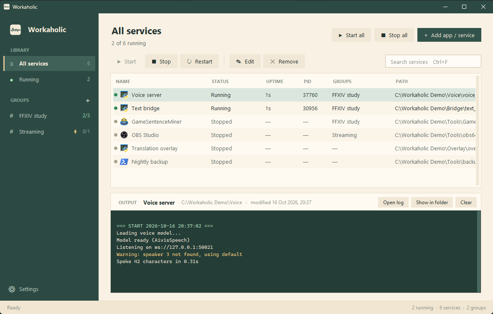
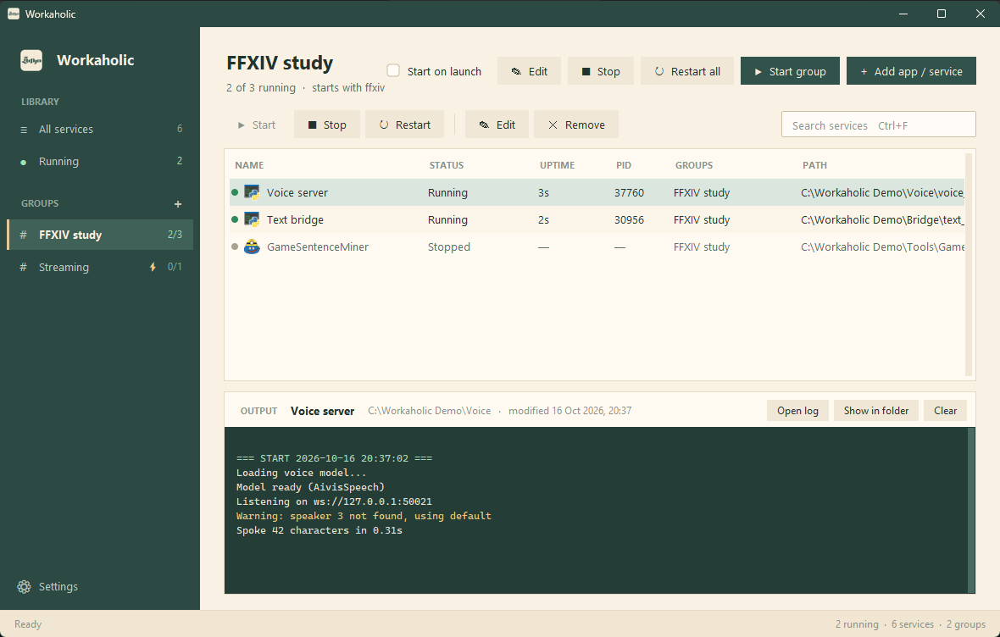
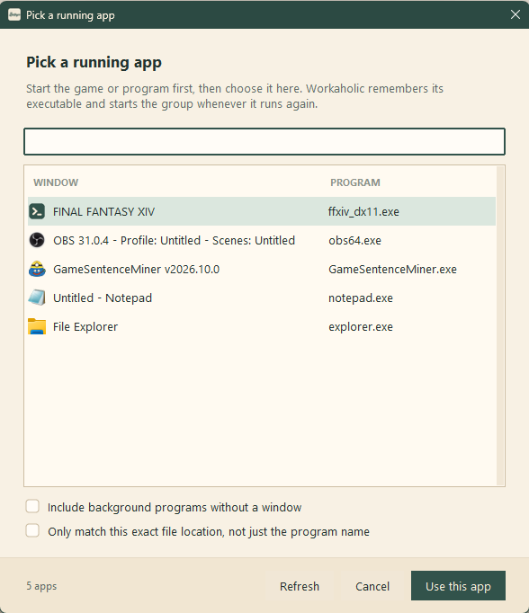
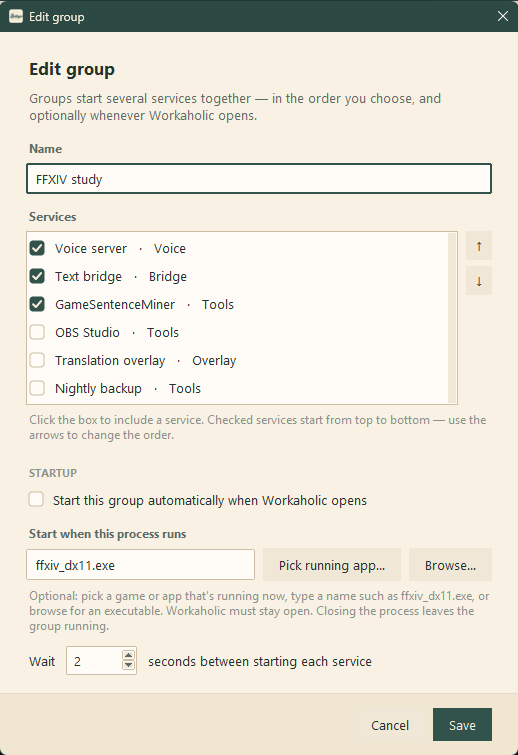
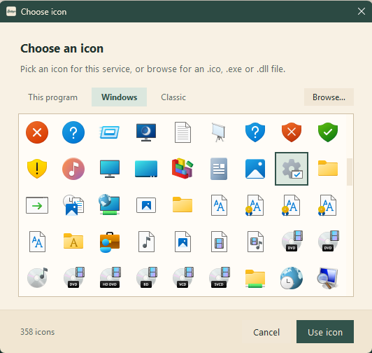

<div align="center">


# Workaholic مرهق

**One window for all the scripts and programs you run together.**<br>
Start them in order, keep an eye on them, and have them launch with your game.

[](https://github.com/KonyAHS/Workaholic/stargazers)
[](https://www.python.org/downloads/)
[](#quick-start)
[](https://github.com/KonyAHS/Workaholic/commits)

[Quick start](#quick-start) · [Features](#features) · [Screenshots](#screenshots) · [Guide](docs/guide.md)



</div>

## Features

- **Services**: add Python scripts, executables, batch files and PowerShell scripts, or search your Start menu apps by name.
- **Groups**: start several services together in your chosen order, with a delay between each.
- **Start with a game**: pick a running app from a list, and the group starts whenever that app runs.
- **Autostart**: launch Workaholic when you sign in, and start chosen groups when it opens.
- **Live output**: each service's log streams into the window, with errors and warnings highlighted.
- **Icons**: every service shows its program's icon, or one you choose.
- **No duplicates**: apps already running elsewhere are detected and left alone.

## Quick start

```powershell
python -m pip install -r requirements.txt
pythonw service_aggregator.py
```

Click **Add app / service**, pick a few programs, then group them from the sidebar.

<details>
<summary><b>Build the Windows executable</b></summary>

<br>

```powershell
powershell -ExecutionPolicy Bypass -File .\build.ps1
```

This creates a single `Workaholic.exe` that runs without Python or a console window. Keep `services_config.json` next to it to bring your services and groups along. The previous build is kept as `Workaholic.previous-<date>.exe`.

</details>

<details>
<summary><b>Keyboard shortcuts</b></summary>

<br>

| Keys      | Action                           |
| --------- | -------------------------------- |
| `Ctrl+N`  | Add services                     |
| `Ctrl+G`  | New group from the selection     |
| `Ctrl+F`  | Search                           |
| `Enter`   | Start or stop the selection      |
| `Ctrl+R`  | Restart the selection            |
| `F2`      | Edit service                     |
| `Del`     | Remove from Workaholic           |
| `Ctrl+,`  | Settings                         |

</details>

<details>
<summary><b>Command-line options</b></summary>

<br>

| Option            | Meaning                                                  |
| ----------------- | -------------------------------------------------------- |
| `--minimized`     | Start minimized                                          |
| `--no-autostart`  | Skip autostart and game-triggered groups this time       |
| `--startup`       | Used by the sign-in entry; honours *Start minimized*     |

</details>

> [!NOTE]
> Python scripts need Python installed, even when you use the compiled executable. Set a specific interpreter per service to use a virtual environment.

## Screenshots

<table>
  <tr>
    <td width="50%"><p align="center"><sub>Groups</sub></p></td>
    <td width="50%"><p align="center"><sub>Start with a running app</sub></p></td>
  </tr>
  <tr>
    <td><p align="center"><sub>Editing a group</sub></p></td>
    <td><p align="center"><sub>Choosing an icon</sub></p></td>
  </tr>
</table>

## Learn more

The **[guide](docs/guide.md)** covers everything in detail: how groups start and restart, game triggers, detecting apps that are already running, where logs go, and how stopping works.

## Contributing

Workaholic is made for my own use, but bug reports and suggestions are welcome.

Run the tests with `python -m unittest test_services -v`.
